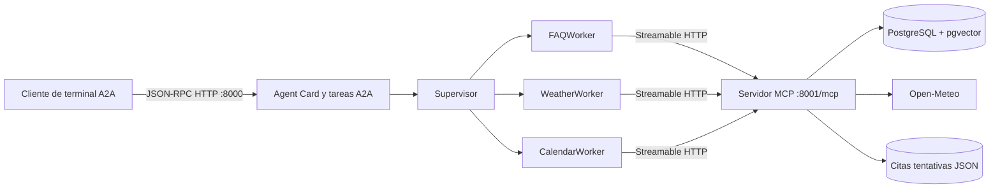

# Hoja de trabajo 7 — Protocolos Agénticos

CC3116 · Parachute S.A. Continuación de HDT3–HDT6, basada en
`main` (`6f249a4`) del repositorio `MarceloDetlefsen/hdt6-ai`.
Los evals, reportes y reglas de negocio de `main` se conservan sin cambios.

Repositorio de entrega: [Hoja de trabajo 7 — Protocolos Agénticos](https://github.com/AI-Engineering-Creativity-2026/Hoja-de-trabajo-7---Protocolos-Ag-nticos).
El repositorio conserva la base de HDT6 y la implementación de HDT7.

El cliente de terminal descubre **un agente A2A** con tres skills: FAQs, clima
y citas. Internamente un supervisor central coordina tres workers del SDK de
OpenAI Agents. Cada worker consume herramientas del **mismo servidor MCP**
por **Streamable HTTP**, con una lista de herramientas permitidas por worker.



## Instalación

Python 3.11+; se comprobó con Python 3.14.8, MCP 2.2.0 y Agents 0.22.2.

```bash
python -m venv .venv
source .venv/bin/activate
python -m pip install -r requirements-protocols.txt -r requirements.txt
cp .env.example .env
```

Configurar Groq (o OpenAI) y PostgreSQL en `.env`. El proceso MCP carga
las variables desde la raíz mediante la integración compartida.
Nunca agregar claves al repositorio.

### Infraestructura RAG real

```bash
docker compose --env-file .env -f hdt4/docker-compose.yml up -d --wait
python hdt4/src/load_corpus.py --help
```

El loader heredado lee `hdt4/.env`, mientras el runtime lee `.env` de la raíz.
Exportar las variables de la raíz para que ambos usen la misma base de datos:

```bash
set -a
source .env
set +a
python hdt4/src/load_corpus.py --corpus data/Corpus_FAQs_Parachute_SA_2026.txt
```

El corpus es el de HDT6, sin inventar información adicional. Algunos registros
contienen respuestas genéricas; el sistema no puede deducir datos ausentes.

## Ejecutar en tres terminales

Activar `.venv` y situarse en la raíz del repositorio en cada terminal.

```bash
# Terminal 1: todas las herramientas y sus logs
python -m protocols.mcp_server
```

```bash
# Terminal 2: fachada A2A y sus logs
python -m protocols.a2a_server
```

```bash
# Terminal 3: cliente A2A interactivo
python -m protocols.client
```

La terminal no requiere API keys, embeddings ni acceso directo a la base.
Para una petición única: `python -m protocols.client '¿Hay parqueo?'`.
`Bye`, `Ctrl-C`, EOF y `salir` cierran la sesión.

Las citas se guardan en `data/citas.json`, que no se versiona.

## Contratos y seguridad meteorológica

- MCP `POST /mcp`: `search_knowledge_base(query)`, `weather_tool(date)` y
  `schedule_tool(date)`. También publica `parachute://safety-policy` y
  el prompt `plan_visit(date)`.
- Cada ejecución registra `tool.start`, `tool.end`/`tool.error`, nombre,
  identificador, resultado operativo y duración. No registra las credenciales.
- A2A `GET /.well-known/agent-card.json`: agente público, skills y capacidades.
- A2A `POST /`: `message/send`, `tasks/get`, `tasks/cancel` sobre JSON-RPC 2.0.
  Las respuestas son tareas con estado `completed` o `failed` y un artefacto
  textual cuando hay éxito. Las tareas terminadas no se pueden cancelar.
- Se eligió **A2A 0.3.0** y su binding JSON-RPC, implementado directamente en
  Starlette/Pydantic. No se usa una API REST inventada ni se necesita el SDK A2A.
  El tutorial `latest` ahora describe A2A 1.0; este cliente negocia explícitamente
  0.3.0. Streaming y push notifications no se anuncian.
- `contextId` conserva la conversación; cada turno genera una tarea nueva.
  Reintentos con el mismo `messageId` y contexto reutilizan la respuesta reciente.
  Contextos, historial y tareas viven en memoria; reiniciar el servidor los borra.
- Solo MCP accede a pgvector, Open-Meteo y citas. El calendario reconsulta el clima
  antes de persistir; no acepta reportes del LLM como autorización. Las reglas
  anteriores y el rango hoy…hoy+15 se conservan.
- Las citas son tentativas y requieren confirmación del instructor. Viento marginal
  permite únicamente tándem experimentado. Los servidores escuchan en loopback.

Los servidores se ejecutan localmente sin autenticación. La persistencia JSON y el lock
son para **un solo proceso MCP**. No ejecutar varios workers sobre el mismo
archivo. A2A conserva hasta 256 contextos, 512 tareas y 32 reintentos por contexto;
los contextos antiguos pueden expirar. No se afirma preparación para producción.

## Pruebas

```bash
python -m unittest discover -s tests -v
```

Las pruebas unitarias cubren reglas meteorológicas, contratos JSON-RPC, errores,
aislamiento de sesiones, contexto y reintentos. Se obtuvieron **21 pruebas aprobadas**.

Para verificar los servidores en procesos separados, el cliente de terminal y
las integraciones PostgreSQL/pgvector, Open-Meteo y Groq/OpenAI:

```bash
python -m scripts.check_network --env-file .env --postgres-port 5432 --postgres-db parachute_faqs
```

Esta verificación necesita credenciales válidas y una base ya cargada. Las citas
se aíslan en un directorio temporal. `--load-corpus` permite cargar el corpus en
la base seleccionada; usarlo con una base exclusiva de validación.

[Guía para grabar el video de entrega](docs/VIDEO.md).

## Ramas para PRs apilados

La implementación conserva esta organización por componentes:

| Rama | Base del PR | Contenido |
| --- | --- | --- |
| `feat/hdt7-mcp` | `main` | Servidor y adaptadores MCP |
| `feat/hdt7-a2a` | `feat/hdt7-mcp` | MAS remoto y fachada A2A |
| `feat/hdt7-terminal` | `feat/hdt7-a2a` | Cliente de terminal |
| `test/hdt7-integration` | `feat/hdt7-terminal` | Contratos y recorrido integral |
| `docs/hdt7-delivery` | `test/hdt7-integration` | Documentación |
| `fix/hdt7-validation` | `docs/hdt7-delivery` | Verificación HTTP con servicios reales |

Las ramas se publican sin crear ni integrar PRs:

```bash
git push origin feat/hdt7-mcp feat/hdt7-a2a feat/hdt7-terminal test/hdt7-integration docs/hdt7-delivery fix/hdt7-validation
```

## Referencias oficiales

- [Servidor MCP](https://modelcontextprotocol.io/docs/2026-07-28/develop/build-server)
- [SDK Python MCP](https://github.com/modelcontextprotocol/python-sdk)
- [MCP en OpenAI Agents](https://openai.github.io/openai-agents-python/mcp/)
- [Especificación A2A 0.3.0](https://a2a-protocol.org/v0.3.0/specification/)
- [Cliente A2A del tutorial](https://a2a-protocol.org/latest/tutorials/python/6-interact-with-server/)
